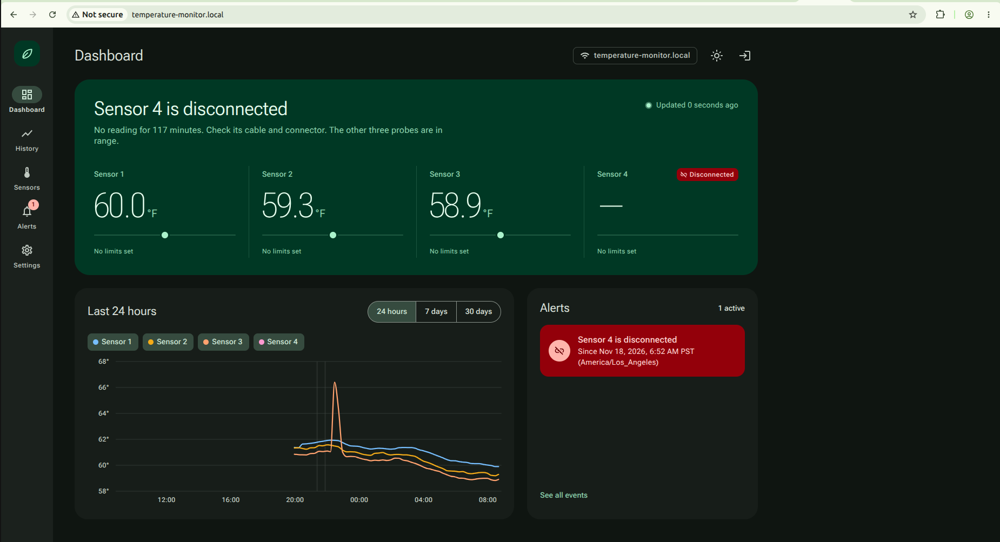
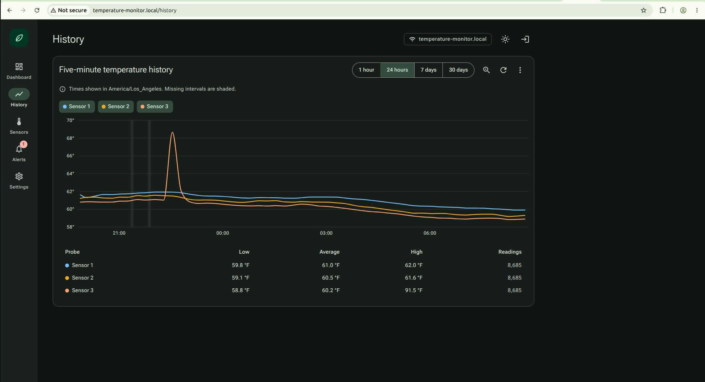
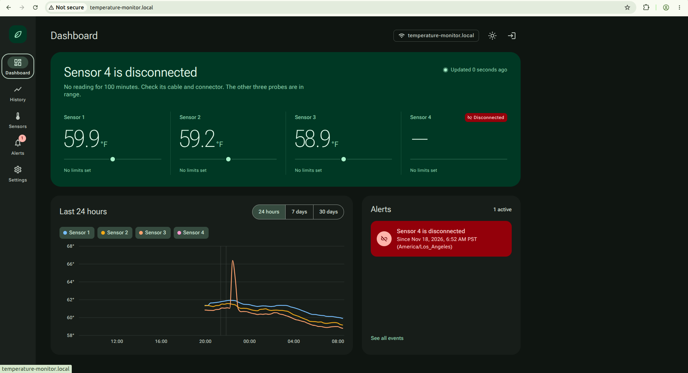
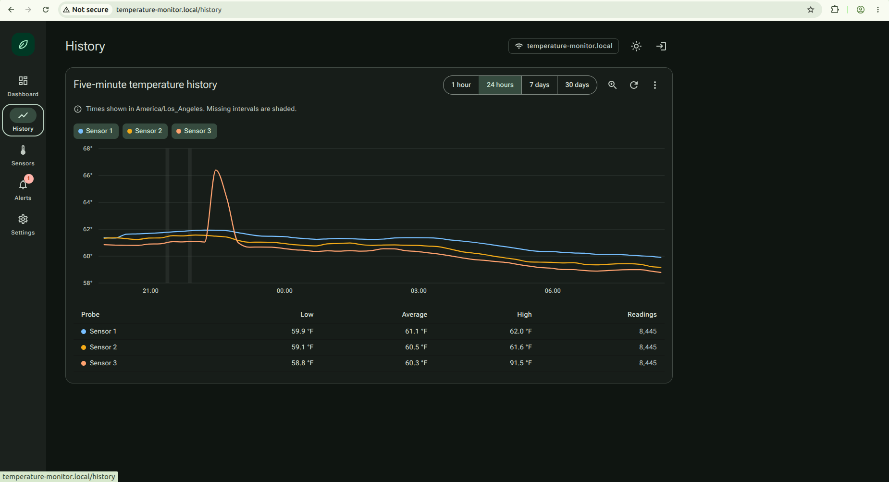

# ESP32-S3 Temperature Monitor

Local-first temperature monitoring for up to five DS18B20 probes on one shared
1-Wire bus, a read-only 1.8-inch ST7735 LCD (an optional 240 × 320 ST7789 build exists), and a
self-hosted React web application.

Firmware implements sensor discovery, calibrated readings, status/alerts,
ROM-keyed settings, five-minute LittleFS history, a protected setup SoftAP,
public read-only HTTP/WebSocket APIs with owner-only changes, and guarded OTA upload/rollback policy.
The React UI includes live dashboard, historical trends/CSV, alerts, sensor
configuration, network/device settings, and firmware/system actions. Native
host tests, simulated network tests, headless LVGL tests and pinned ESP-IDF
v6.1 firmware builds run in CI; selected USB-loopback bare-board checks have
also been recorded separately in `docs/validation/`.

The LCD runtime includes ST7735/ST7789 SPI and LVGL integration, but **physical panel
orientation, color, backlight voltage and refresh timing are not qualified**.
GPIO15 backlight drive must remain disconnected/disabled until the panel's
electrical behavior is confirmed. Physical DS18B20 probes, five-probe soak,
owner-network onboarding, OTA slot transitions, LittleFS power-loss recovery
and destructive reset acceptance remain open. Simulations do not close those
gates. No cloud service is required for local sensor acquisition.

- [Requirements](docs/SPEC.md)
- [Implementation checklist](docs/TODO.md)
- [Development and verification](docs/DEVELOPMENT.md)
- [Progress and limitations](docs/PROGRESS.md)
- [Wiring and hardware hold points](docs/ESP32_S3_TEMPERATURE_MONITOR_WIRING.md)

Start with `./tools/verify.sh`. Firmware builds require the pinned ESP-IDF
v6.1 environment; see the development guide for setup, flashing and simulation.

## Screenshots

Taken from the web app served by the board on 2026-11-18 (dark theme).

_Dashboard: live readings from each probe, a status summary (here, Sensor 4 is disconnected),
the active alerts, and the last 24 hours of temperatures._

_History: the five-minute temperature history for a chosen range (1 hour to 30 days), with
missing intervals shaded and each probe's low, average, high and reading count._

_The Dashboard navigated by keyboard: the focused item in the navigation rail is outlined._

_The History page navigated by keyboard, with the 24-hour range selected._
