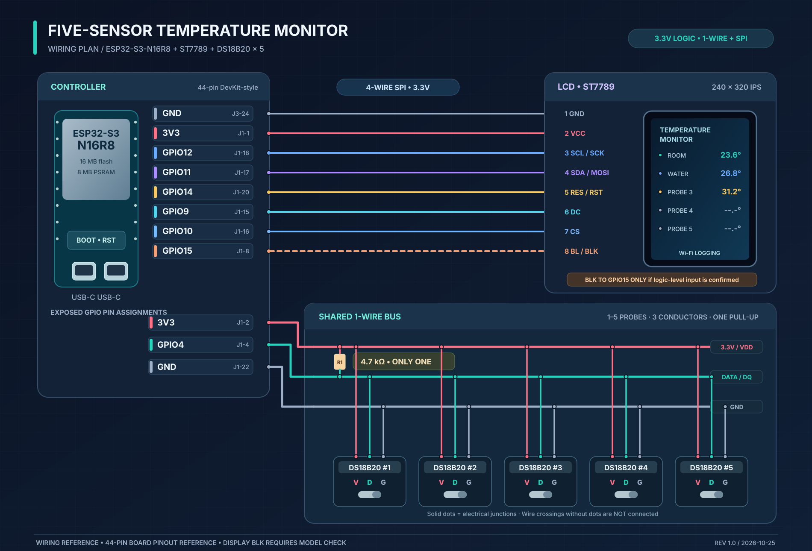

# ESP32-S3 Five-Sensor Temperature Monitor — Wiring Guide

**Revision:** 1.0 · 2026-10-25  
**Board:** ESP32-S3-N16R8 (44-pin dual-USB-C DevKit-style board shown in photos)  
**Display:** 2.8-inch 240 × 320 ST7789, 4-wire SPI, 8-pin header (as inferred from photos)  
**Temperature sensors:** Up to five waterproof DS18B20 probes, one shared 3-wire 1-Wire bus

> **Important — verify before powering:** The display's backlight pin (`BL`/`BLK`) cannot be conclusively identified as a logic-level enable from the provided photos. All other connections below are the selected design. The `GPIO15 → BLK` wire in the drawing is **dashed / conditional**: connect it only after confirming that the LCD board accepts a 3.3 V logic-level backlight signal. If the pin instead exposes a raw backlight LED terminal, it needs an appropriate driver, not a direct GPIO connection. Also verify the LCD header's actual pin names/order and the probe wire colors on your particular parts.

## Wiring diagram



[Open the standalone SVG wiring diagram](esp32_s3_temperature_wiring.svg)

> The SVG is a **net/wiring schematic**, not a to-scale drawing of the physical header positions. Use the GPIO/silkscreen names and the board-header references below to find the correct holes. **A filled junction dot indicates an electrical connection; crossed lines without a dot are *not* connected.**

## 1. LCD: ESP32-S3 ↔ ST7789 (SPI)

| LCD header signal | LCD header position* | ESP32-S3 signal | Board header position** | Purpose |
|---|---:|---|---|---|
| `GND` | 1 | `GND` | J3-24 (or any GND) | Common ground |
| `VCC` | 2 | `3V3` | J1-1 | 3.3 V supply — **not 5 V** |
| `SCL` / `SCK` | 3 | `GPIO12` | J1-18 | SPI clock |
| `SDA` / `MOSI` | 4 | `GPIO11` | J1-17 | SPI MOSI / write data |
| `RES` / `RST` | 5 | `GPIO14` | J1-20 | Active-low LCD reset |
| `DC` / `RS` | 6 | `GPIO9` | J1-15 | Data / command selection |
| `CS` | 7 | `GPIO10` | J1-16 | Active-low chip select |
| `BL` / `BLK` | 8 | `GPIO15` **conditional** | J1-8 | Backlight control **only if logic-level compatible** |

\* Header order is the *common eight-pin ST7789 SPI module* convention, **not confirmed by readable pin labels in your photo**. Follow the actual printed signal labels if your module differs.  
\** `J1` is the **left** 22-pin header with the antenna at the top and USB connectors at the bottom; `J3` is the **right** 22-pin header, same orientation. Counts run from the antenna end toward USB, consistent with the 44-pin YD/DevKit-style reference. Board revisions may differ, so prioritize the GPIO silkscreen label.

**There is no LCD MISO wire in this write-only SPI arrangement.** Backlight brightness via GPIO15/PWM is optional and depends on confirmed backlight hardware. To bring up the logic interface, you can leave `BLK` unconnected until you identify its electrical function; the screen may remain dark in that state.

## 2. All five DS18B20 probes: one shared 1-Wire bus

| ESP32-S3 signal | Board header position | Connect to *every* attached probe |
|---|---|---|
| `3V3` | J1-2 | `VDD` / positive supply wire |
| `GPIO4` | J1-4 | `DQ` / data wire |
| `GND` | J1-22 | `GND` / return wire |

**Pull-up resistor:** install **one** 4.7 kΩ resistor **between `3V3` and `GPIO4`/`DQ`**, close to the ESP32. This is a **parallel (shunt) connection between power and data**, **not a resistor in series** with the data wire. A ¼-watt resistor is more than sufficient. Use normal three-wire powered mode (VDD, DQ, GND); **do not use parasite-power mode**.

All five sensor leads connect to the same three nodes. They are **electrically parallel**, even if you arrange them physically along a daisy-chain cable. The ESP32 discovers individual probes by their unique 64-bit ROM identifiers.

| Probe | VDD | DQ | GND |
|---|---|---|---|
| DS18B20 #1 | Shared `3V3` | Shared `GPIO4` | Shared `GND` |
| DS18B20 #2 | Shared `3V3` | Shared `GPIO4` | Shared `GND` |
| DS18B20 #3 | Shared `3V3` | Shared `GPIO4` | Shared `GND` |
| DS18B20 #4 | Shared `3V3` | Shared `GPIO4` | Shared `GND` |
| DS18B20 #5 | Shared `3V3` | Shared `GPIO4` | Shared `GND` |

You can plug in **any number from one to five**; no extra resistors are needed when adding sensors. The **five small screw-terminal breakout boards are optional and not used in this diagram**. If you do use one or more, first check for preinstalled pull-up resistors, so they are not unintentionally placed in parallel with R1.

**Common lead colors (verify yours):** red = `VDD`, black = `GND`, yellow/white = `DQ`. Waterproof probe lead-color conventions are **not universal**; confirm with the seller's pinout or a continuity check before powering.

## 3. Shared connections and parts

| Item | Quantity | Notes |
|---|---:|---|
| ESP32-S3-N16R8 44-pin board | 1 | Powered from a suitable USB-C supply |
| 2.8-inch ST7789 SPI TFT module | 1 | 3.3 V supply and 3.3 V I/O assumed |
| Waterproof DS18B20, three-wire | Up to 5 | Individually addressed in firmware |
| **4.7 kΩ resistor** | **1** | Between shared data and 3.3 V |
| Three-conductor wiring / terminal strips | As needed | For `3V3`, `DQ`, `GND` distribution |
| Jumper wires for LCD | As needed | LCD needs at least 7 connections; optional eighth BLK |

**GPIOs consumed:** six required (`GPIO4`, `GPIO9`, `GPIO10`, `GPIO11`, `GPIO12`, `GPIO14`) plus `GPIO15` if the LCD backlight supports direct GPIO-level control. LCD and sensors share power/ground but **not data GPIOs**.

## 4. Recommended assembly and verification

1. **Unplug USB power** while wiring. Find the pins by their **silkscreened GPIO names**. Never connect `5V` to a 3.3 V-only I/O pin.
2. Connect the LCD's ground, power and five SPI/control pins first (leave `BL/BLK` aside pending verification). Check whether the LCD PCB specifies a backlight *logic input* or a *direct LED terminal* before completing that wire.
3. Connect one DS18B20 probe to the shared `3V3`, `GPIO4`, and `GND` conductors. Install **one 4.7 kΩ pull-up from `GPIO4` to `3V3`**.
4. Before power-on, use a multimeter to check that `3V3` and `GND` are not shorted; measure about 4.7 kΩ between `GPIO4` and `3V3` **with sensors detached** (when no extra pull-ups are installed).
5. Apply power and test reading one temperature sensor. Add the other four probes one at a time, checking that device discovery finds 1, 2, 3, 4 and 5 unique ROM IDs.
6. Bring up the ST7789 test pattern, then LVGL UI. Confirm backlight wiring separately; a black screen may mean only that the backlight is off.
7. For the longer bus, prefer a **three-wire trunk with short sensor branches** over five long star-shaped branches. If communication is intermittent, reduce stub lengths, inspect connections, and check bus rise time and pull-up value.
8. In firmware, use the ESP-IDF RMT-backed 1-Wire bus on `GPIO4`, with sensor polling and CRC checks. No five-channel RMT allocation is required.

### Firmware pin configuration (reference)

```c
// DS18B20: single shared 1-Wire bus
#define PIN_ONEWIRE_DATA     4

// ST7789: 4-wire SPI + control
#define PIN_LCD_SCLK       12
#define PIN_LCD_MOSI       11
#define PIN_LCD_CS         10
#define PIN_LCD_DC          9
#define PIN_LCD_RST        14
#define PIN_LCD_BL         15  // Only after confirming compatible BLK control
```

### Hardware checks still required

- **LCD BLK:** Its electrical polarity/current-driving requirement is **not verified** from the provided pictures. Verify before wiring to GPIO15.
- **LCD header order:** The standard GND–VCC–SCL–SDA–RST–DC–CS–BLK sequence matches common modules, but check the actual board markings.
- **Probe colors:** Verify actual VDD/DQ/GND colors; do not assume them solely from the cable jacket.
- **3.3 V supply budget:** Confirm the board's 3.3 V regulator supports the LCD/backlight plus the ESP32 and five probes. If the backlight needs its own supply/driver, follow its datasheet.

## References

- ESP32-S3 44-pin DevKit/YD-style header layout: https://github.com/profharris/YD-ESP32-S3_ESP32-S3-WROOM-1_Dev
- ST7789 2.8-inch SPI module reference pin names: https://manuals.plus/ae/1005010609258949
- DS18B20 datasheet, multi-drop and pull-up wiring: https://www.analog.com/media/en/technical-documentation/data-sheets/DS18B20.pdf
- Analog Devices 4.7 kΩ pull-up guidance: https://support.analog.com/en-US/knowledgebase/article/000094969
